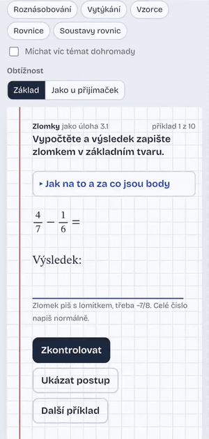
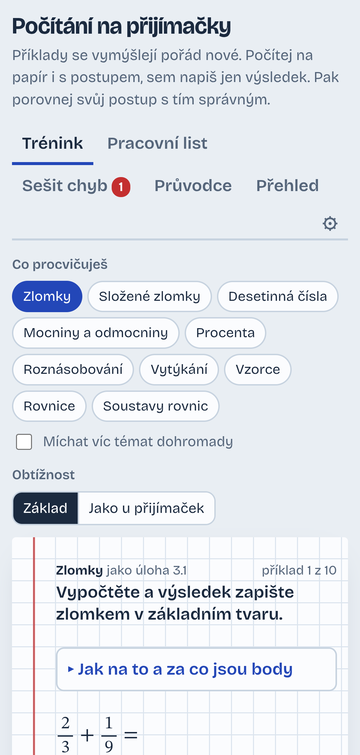
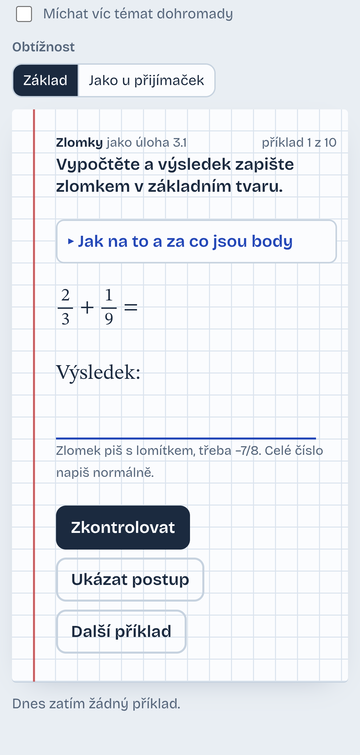
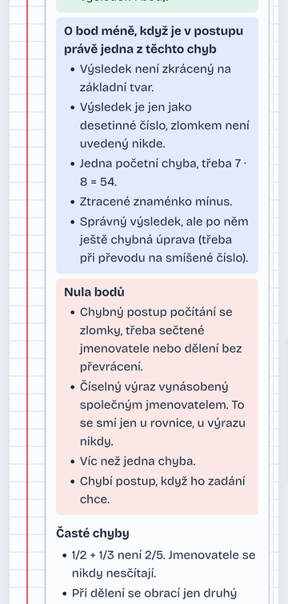
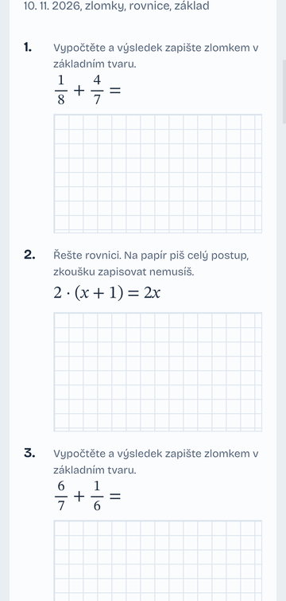
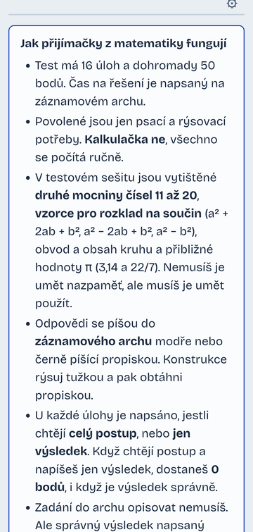

# Počítání na přijímačky – Android

Tenký obal (WebView) kolem stránky `app/src/main/assets/index.html` (kód je v podsložkách `css/` a `js/`): trénink matematiky a češtiny na přijímačky. Vše běží v telefonu,
internet je potřeba jen pro vysvětlování přes OpenRouter (a pro webové fonty; bez nich se použijí systémové).

## Jak to vypadá
Ukázka z telefonu (verze 1.7, zrychleno): správná odpověď a postup, výběr tématu, špatná odpověď s tipem, sešit chyb, přehled a pracovní list.
Video ve větším rozlišení: [docs/demo.mp4](docs/demo.mp4).



Snímky z telefonu (verze 1.7).

| Trénink | Příklad | Za co jsou body |
|:---:|:---:|:---:|
|  |  |  |
| **Pracovní list** | **Průvodce** | |
|  |  | |

## Build
1. `cp local.properties.example local.properties` a doplň `sdk.dir`, `OPENROUTER_KEY`, `OPENROUTER_MODEL`.
2. Otevři v Android Studiu (vygeneruje Gradle wrapper), nebo `gradle wrapper && ./gradlew assembleRelease`.
3. APK: `app/build/outputs/apk/release/app-release.apk` → nainstaluj (`adb install ...`).

Verze AGP/Kotlinu/knihoven jsou z doby psaní; pokud Studio nabídne novější, klidně aktualizuj.

## Klíč
- Klíč lze od verze 1.1 zadat přímo v aplikaci: tlačítko ⚙ v pravém horním rohu („Vysvětlování přes AI“). Uloží se do localStorage zařízení, má přednost před `local.properties` a do gitu ani APK se nedostane.
- Alternativně (stejně jako dřív) se dá klíč i model zapsat do `local.properties` → `BuildConfig`; z APK se ale dají vytáhnout.
- Na openrouter.ai nastav u klíče **kreditní limit**.

## Aktualizace stránky
Stránku tvoří `app/src/main/assets/index.html` (jen markup a odkazy) a soubory ve složkách `css/` a `js/` vedle ní;
APK je načte z assets bez dalších úprav. Po změně v nich se znovu sestaví APK a webová verze:
`node nastroje/sestav-web.mjs` vloží styly a skripty do jednoho souboru `pocitani-na-prijimacky.html`
(`--check` jen ověří, že je soubor aktuální).
Data (statistiky, sešit chyb) jsou v localStorage WebView a aktualizaci aplikace přežijí
(odinstalace je smaže).

## Testy CERMAT v telefonu
Záložka **Testy CERMAT** ukazuje oficiální testy přijímaček (2023–2026, 16 testů na předmět) se správnými
odpověďmi a zdůvodněním. Testy **nejsou v APK ani v gitu** (autorská práva CERMAT), do telefonu nebo tabletu
se nahrají zvlášť. Bez nich záložka ukáže jen návod.

### Co se nahrává
Datovou složku vytvoří na počítači nástroje v `nastroje/cermat-tau/` (postup v `nastroje/cermat-tau/README.md`).
Výsledek je složka `cermat-tau/` v kořeni repozitáře (je v `.gitignore`):

```
cermat-tau/
  cestina/                    čeština, asi 270 MB
    prehled-testu.json        seznam testů (podle něj aplikace pozná, že je předmět nahraný)
    odpovedi/2026-RT1.json …  zadání, možnosti a správné odpovědi (16 souborů)
    obrazky/tasks/<id>/…      obrázky zadání, řešení a bodovacích klíčů
  matematika/                 matematika, asi 30 MB, stejná struktura
```

Názvy složek `cestina` a `matematika` se nesmí měnit, podle nich aplikace pozná předmět. Ostatní soubory ve složce
(`testy/`, `data.js`, `prohlizec.html` …) nevadí, aplikace je při nahrávání přeskočí.

### Nahrání přetažením (doporučeno)
1. Připoj telefon nebo tablet k počítači kabelem a v zařízení zvol **Přenos souborů**.
2. V průzkumníku Windows přetáhni složku `cermat-tau\cestina` do zařízení, třeba do složky **Download**.
   Můžeš přetáhnout i celou `cermat-tau` (oba předměty najednou).
3. V aplikaci přepni předmět (Matematika / Čeština), otevři **Testy CERMAT** → **Nahrát testy**
   a v systémovém výběru vyber přetaženou složku (`cestina`, nebo `cermat-tau`).
4. Aplikace si data zkopíruje do své soukromé složky a ukazuje průběh. Čeština trvá zhruba minutu.
5. Po dokončení se objeví seznam testů. Kopii v **Download** pak můžeš smazat, aplikace ji už nepotřebuje.

### Nahrání přes adb
Data jdou poslat rovnou do soukromé složky aplikace, bez výběru v aplikaci. Aplikace musí být nainstalovaná
a aspoň jednou spuštěná:

```bash
adb push cermat-tau/cestina    /sdcard/Android/data/cz.jarda.matika/files/cermat/
adb push cermat-tau/matematika /sdcard/Android/data/cz.jarda.matika/files/cermat/
```

V **Git Bashi** na Windows dej před příkaz `MSYS_NO_PATHCONV=1`, jinak Git Bash přepíše cestu `/sdcard/…`
na `C:/Program Files/Git/sdcard/…` a nahrávání se zasekne. V PowerShellu nebo cmd to není potřeba.
Kontrola: `adb shell ls /sdcard/Android/data/cz.jarda.matika/files/cermat/cestina` vypíše
`obrazky  odpovedi  prehled-testu.json`.

### Kde data v zařízení jsou
`/sdcard/Android/data/cz.jarda.matika/files/cermat/<předmět>/`. Aplikace je čte bez internetu a bez jakéhokoli
oprávnění. Aktualizace aplikace je nesmaže, **odinstalace ano** (pak je nahraj znovu). Správci souborů na Androidu 11
a novějším tuto složku nezobrazují, proto se data nahrávají přes aplikaci nebo adb.

### Aktualizace a odstranění
- Nová data (třeba testy dalšího roku): stáhni je na počítači znovu a nahraj stejným postupem. Soubory se stejnou
  velikostí se přeskočí, takže to jde rychle.
- Smazání jednoho předmětu: `adb shell rm -r /sdcard/Android/data/cz.jarda.matika/files/cermat/cestina`
  (smaže jen data testů, statistiky a sešit chyb zůstanou).

### Když to nejde
- **„Ve vybrané složce není složka cestina ani matematika“**: vybral(a) jsi jinou složku. Vyber přímo `cestina`
  nebo složku, ve které `cestina` je.
- **„Chybí prehled-testu.json nebo složka odpovedi“**: data na počítači nejsou úplná, spusť stahování znovu.
- **Seznam testů je prázdný**: zkontroluj, že je zvolený správný předmět (data češtiny se ukážou jen v češtině).
- **Webová verze** (`pocitani-na-prijimacky.html` v prohlížeči) čte testy ze složky `cermat/<předmět>/` vedle stránky
  a musí běžet přes webový server, třeba `python -m http.server` (ze souboru `file://` prohlížeč data nenačte).

## Struktura
```
app/src/main/assets/index.html   markup a odkazy na styly a skripty, WebView ji načítá z assets
  css/                           zaklad.css, cestina.css (téma češtiny), cermat.css
  js/                            config, jadro (zlomky, výrazy, parser, kontrola), temata
    matematika/                  generátory příkladů (zaklady, zlomky, vyrazy, rovnice, slovni, promenna)
    cestina/                     generátory pravopisu
    data/                        slovni.js a cestina.js (generované z ulohy/), promenna.js
    ui/                          rozhraní: stav, trénink, AI, list, sešit chyb, přehled, papír, routing, start
    cermat/                      Testy CERMAT a zvětšení obrázku
pocitani-na-prijimacky.html      stejná stránka pro prohlížeč, sestavená z index.html (node nastroje/sestav-web.mjs)
nastroje/sestav-web.mjs          sestaví webovou verzi do jednoho souboru
ulohy/                           zdroje úloh, ze kterých se generují soubory js/data/slovni.js a cestina.js
  slovni/                        slovní úlohy z matematiky: ulohy.json, overit.js, vlozit.js
  cestina/                       věty pro pravopis: vety.json, vlozit.js
nastroje/cermat-tau/             stažení oficiálních testů CERMAT TAU a lokální prohlížeč s odpověďmi
app/src/main/java/…/CermatData.kt  nahrání testů CERMAT do telefonu a jejich čtení ve WebView (/cermat/…)
cermat-tau/                      stažená data CERMAT, jen lokálně (mimo git, autorská práva)
docs/                            rozbor úloh CERMAT, snímky a ukázka
tests/                           automatické testy (node --test tests/)
```
Pořadí skriptů v `index.html` je pořadí závislostí (config, jádro, data, generátory, témata, rozhraní, start); jsou to
klasické skripty (ne moduly), takže sdílejí globální jména a webová verze běží i ze souboru. Žádný řádek kódu
(mimo `js/data/`) nepřesáhne 200 znaků a `index.html` zůstává krátká, hlídá to test.
Generátory příkladů z matematiky jsou v `js/matematika/`. Data slovních úloh a vět z češtiny se upravují
ve složce `ulohy/` a soubory `js/data/slovni.js` a `js/data/cestina.js` z nich vytvoří
`node ulohy/slovni/vlozit.js` a `node ulohy/cestina/vlozit.js` (ručně se neupravují).
Formát popisují `ulohy/slovni/FORMAT.md` a `ulohy/cestina/FORMAT.md`.

## Testy
Sada automatických testů ověřuje JavaScriptovou logiku WebView aplikace, generování příkladů, evaluátor výrazů, slovní úlohy, češtinu a konzistenci souborů:
```bash
node --test tests/
```

